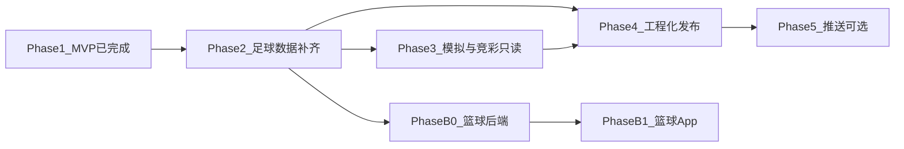

# 欢哥竞球 APP 后续开发方案

> 生成日期：2026-11-06  
> 对象：Flutter 客户端 `flutter/`（应用名 **欢哥竞球**，英文品牌 TraeSolo）  
> 依据：当前 MVP 代码、`flutter/docs/DESIGN.md`、后端 `/api/v1`、仓库 `AGENTS.md` 与既有 Web 能力  
> **产品边界**：仅供学习、研究与数据分析；文案与 UI 不得构成投注建议，禁止赌博引导。

---

## 一、定位与原则

| 项 | 约定 |
|---|---|
| 产品名 | **欢哥竞球**（桌面显示名）；包名/工程仍为 `traesolo` |
| 品类 | 当前：**足球**；后续：**篮球**（赛事列表 + 预测展示） |
| App 角色 | **消费端**：浏览、关注、预测只读、模拟推演 |
| Web 角色 | **运营端**：采集、训练、权限、调度、风控配置 |
| 模型 | 不在 App 内跑 ELO/泊松/xG/蒙特卡洛；一律走后端 |
| API | 统一 ` /api/v1`；BaseUrl 编译期 `--dart-define=API_BASE_URL` 或 `AppConfig` 默认值 |

原则：

1. **足篮可切换、架构先预留**：UI 用「运动项目」维度，避免写死「足球」文案与路由。
2. **先复用足球后端，篮球单独立项**：篮球需独立数据源、表结构与模型，不与足球表硬混。
3. **运维能力不上 App**：爬虫、训练、用户/角色管理、定时任务留在 Web。
4. **性能**：列表默认 `view=summary`；详情按场次取预测，禁止默认批量 `recalculate`。

---

## 二、现状（截至 2026-11-06 夜）

### 2.1 已交付（MVP / Phase 1～3.4 + Phase 4 工程基线）

| 能力 | 说明 |
|---|---|
| 登录 / 验证码 PNG hex / 强制改密 / 登出 | 对齐 Web 鉴权 |
| 首页 + 免责声明 + 关注流 | 底部导航：[首页][赛事][数据][竞彩][我的]；`/follows/summary` |
| 赛事未赛 / 已赛 + 筛选 + 分页 | 联赛 / 日期 / 关键词；下拉刷新 / 加载更多 |
| 赛事详情 + 预测增强 + 收藏 | 堆叠胜平负条、主线比分、场景说明；收藏赛事 |
| 数据 Tab：联赛积分榜 / 射手榜 | `/leagues/`、`/standings`、`/scorers`；星标关注 |
| 球队详情 | `/teams/{id}` + 积分行 + 近期完赛入口 |
| 个人中心 + 关于页 | 改密入口、版本号、`APP_ENV`、免责声明 `/about` |
| 单场模拟推演 + 本场历史 + λ 敏感性 | simulate / history / sensitivity；需 `simulation:view` |
| 赔率快照只读 | `/matches/{id}/odds-snapshots`；权益 `odds:snapshot` |
| 竞彩只读 + 分页 | 在赛/历史；`/matches/jingcai/bf*`；无运维刷新 |
| 深链 | `huange://open/match/{id}` → `/match/:id` |
| 环境 / Release | `APP_ENV` + `API_BASE_URL` dart-define；main 禁 cleartext；`key.properties` + minify |
| CI | `.github/workflows/ci.yml` 含 `flutter analyze` + `flutter test` |
| 队徽缓存 / 无障碍 | `TeamLogo` + `/static/` 同源解析；列表 Semantics；字号 0.9～1.35 |
| 详情离线缓存 | 打开成功写缓存；网络失败读本地；过期仍可兜底并提示 |
| 命名与主题 | 欢哥竞球 + 深色职业分析色板 |

### 2.2 明确未做

- Phase 3.3 / 3.5：λ 敏感性、赔率快照（可选）
- Phase 5：推送
- 篮球全链路
- iOS 上架流程

### 2.3 工程索引

| 路径 | 用途 |
|---|---|
| `flutter/lib/` | 业务代码 |
| `flutter/docs/DESIGN.md` | 客户端设计摘要 |
| `flutter/README.md` | 本机 SDK、BaseUrl、构建说明 |
| `DOC/本文档` | APP 后续开发权威规划 |

---

## 三、信息架构演进

### 3.1 近期（仍以足球为主）

```
登录 → (强制改密?) → Shell
  ├─ 首页（关注摘要 / 今日赛事入口 / 免责声明）
  ├─ 赛事（未赛 | 已赛，可筛联赛）
  │    └─ 赛事详情 → 预测卡片 / 简要交锋
  ├─ 数据（积分榜 | 射手榜）     ← Phase 2 新增 Tab 或入口
  └─ 我的（资料 / 改密 / 关于 / 退出）
```

### 3.2 足篮双项目（Phase B）

```
Shell 顶栏或首页： [足球] [篮球]
  └─ 各项目独立：赛事 / 数据 / 详情 / 预测
```

切换「运动项目」只影响数据源与文案，共享登录会话与个人中心。

---

## 四、分阶段路线图

### Phase 2 — 足球体验补齐（优先，约 2～3 周）

**目标**：达到「能日常看赛 + 看预测 + 查联赛数据」的可用版。

| # | 功能 | 后端依赖（已有优先） | 备注 |
|---|---|---|---|
| 2.1 | 联赛列表 + 积分榜 | `/leagues`、`/standings` | ✅ |
| 2.2 | 射手榜 | `/scorers` | ✅ |
| 2.3 | 球队详情（简介、近期战绩入口） | `/teams/{id}` | ✅ 图表后置 |
| 2.4 | 关注联赛 / 收藏赛事 | `/follows`、`/favorites` | ✅ 首页关注流 |
| 2.5 | 赛事列表筛选（联赛、日期、关键词） | upcoming/finished 查询参数 | ✅ |
| 2.6 | 预测展示增强 | 详情已有字段 | ✅ 堆叠胜平负条 + 主线比分 + 场景说明（未引 fl_chart） |
| 2.7 | 错误与空态统一 | — | ✅ `AsyncStatePane` 覆盖 401/403/网络/空数据 |
| 2.8 | 关于页 + 版本号 + 免责声明固定入口 | — | ✅ `/about`，我的页入口 |

**验收**：真机/模拟器登录 → 浏览未赛 → 打开预测 → 查看积分榜；无运维入口。

### Phase 3 — 模拟与竞彩只读（约 2 周）

| # | 功能 | 后端依赖 | 约束 |
|---|---|---|---|
| 3.1 | 模拟预测（单场） | `POST /predictions/simulate` | ✅ 赛事详情；App 上限 20000 次；无权限友好提示 |
| 3.2 | 模拟历史摘要 | `GET /predictions/simulate/history` | ✅ 本场最近记录 |
| 3.3 | λ 敏感性（可选） | `/predictions/simulate/sensitivity` | ✅ 表格 + 胜平负条；App 上限 5000 次/点 |
| 3.4 | 竞彩分析只读浏览 | 现有 jingcai 相关 API（与 Web 对齐） | ✅ 在赛/历史；无刷新/配置；禁止投注文案 |
| 3.5 | 赔率快照只读（可选） | `/matches/{id}/odds-snapshots` | ✅ 权益 `odds:snapshot`；FEATURE_LOCKED 友好提示 |

**验收**：模拟结果可复现展示；文案审核通过（无投注建议措辞）。

### Phase 4 — 体验与工程化（约 1～2 周，可与 3 并行）

| # | 项 | 说明 |
|---|---|---|
| 4.1 | 下拉刷新 / 分页加载更多 | ✅ 赛事 + 竞彩 |
| 4.2 | 图片缓存 | ✅ `TeamLogo` + `resolveMediaUrl`；赛事/竞彩/详情/积分榜 |
| 4.3 | 离线缓存最近详情 | ✅ SharedPreferences JSON；LRU 20；TTL 24h；失败回退 + 横幅 |
| 4.4 | 深链 `huange://open/match/{id}` | ✅ Android 自定义 Scheme + `/match/:id` |
| 4.5 | 环境配置 | ✅ `APP_ENV` / `API_BASE_URL` dart-define |
| 4.6 | CI | ✅ `flutter analyze` + `flutter test` |
| 4.7 | 发布包 | ✅ 签名模板、混淆、main 禁 cleartext；生产 HTTPS |
| 4.8 | 无障碍与横竖屏 | ✅ Semantics、字号钳制 0.9～1.35、底栏 tooltip |

### Phase 5 — 推送与提醒（可选，依赖后端）

| # | 项 | 说明 |
|---|---|---|
| 5.1 | 后端：设备 Token 登记、用户订阅赛事/联赛 | 新表 + API |
| 5.2 | FCM / 厂商推送 | 赛前提醒、关注联赛开赛 |
| 5.3 | 通知文案 | 仅赛程/数据提醒，禁止赔率诱导 |

### Phase B — 篮球专项（独立里程碑，排在足球 Phase 2～3 稳定后）

篮球不是「换个 Tab 文案」，需后端与数据先行。

#### B0 后端就绪（App 开始前的门禁）

| # | 项 | 说明 |
|---|---|---|
| B0.1 | 运动类型模型 | `sport_type=football\|basketball` 或独立表前缀 / 独立库 schema |
| B0.2 | 篮球联赛 / 球队 / 赛事采集 | 新爬虫或供应商；写入篮球域表 |
| B0.3 | 篮球预测模型 | 可先简化（ELO + 泊松类比或独立 ensemble）；权重与足球隔离 |
| B0.4 | API | 建议 `/api/v1/basketball/...` 或统一资源加 `sport` 查询参数；**二选一并写进 OpenAPI** |
| B0.5 | 权限与订阅 | 篮球功能码 / feature flag |

**门禁**：无稳定篮球 `upcoming` + `prediction` 接口前，App 只放「即将推出」占位，不接假数据。

#### B1 App 接入

| # | 功能 |
|---|---|
| B1.1 | 全局运动切换（足球 / 篮球） |
| B1.2 | 篮球赛事列表 / 详情 / 预测只读 |
| B1.3 | 篮球积分榜或分区榜（按联赛形态） |
| B1.4 | 文案与术语（胜负、分差、让分等，避免套用足球「胜平负」硬翻） |
| B1.5 | 回归足球路径无回归缺陷 |

---

## 五、技术债务与规范（贯穿）

| 项 | 建议 |
|---|---|
| 跨盘编译 | 已设 `kotlin.incremental=false`（Pub 在 C:、工程在 E:）；文档保留 |
| BaseUrl | 生产必须 HTTPS；禁止把内网 IP 写死进 release（用 CI `dart-define`） |
| 验证码 | 继续 hex PNG；勿回退 SVG |
| Riverpod 3 | 禁用已移除的 `StateProvider`，统一 `Notifier` |
| 文案审核清单 | 每版发版前：搜索「投注」「稳赢」「推荐购买」等禁用词 |
| 与 Web 契约 | 后端变更同步 `frontend/src/api/*` 与 `flutter/lib/data/api/*` |
| 测试 | 模型解析单测 + 关键 Repository mock；UI 少做真实网络 widget 测 |

---

## 六、建议排期总览



| 阶段 | 前置 | 产出 |
|---|---|---|
| Phase 2 | MVP | 足球可用日活版 |
| Phase 3 | Phase 2 | 模拟 + 竞彩只读 |
| Phase 4 | Phase 2 | 可签名发布的工程基线 |
| Phase 5 | Phase 4 + 后端推送 | 赛前提醒 |
| Phase B | 足球稳定 + B0 接口就绪 | 足篮双项目 |

---

## 七、非目标（本方案不承诺）

- App 内训练模型、触发全量爬虫、改融合权重
- App 内用户/角色/权限管理
- 把 Web 运维大盘（调度、质量告警）搬进手机
- 赌博、代购、赔率「推荐下注」类能力
- 未就绪时用 Mock 篮球数据上线误导用户

---

## 八、下一步立刻可做（建议）

1. 定稿 **篮球 API 形态**（独立前缀 vs `sport` 参数），写入后端设计后再动表。  
2. **Phase 5**（依赖后端）：设备 Token / 赛前提醒。  
3. 每完成一阶段，更新本文「现状」表与 `flutter/docs/DESIGN.md` 路线图。

---

## 九、修订记录

| 日期 | 说明 |
|---|---|
| 2026-11-06 | 初版：基于 MVP 与足篮双项目规划 |
| 2026-11-06 | Phase 2.1～2.4 落地：数据 Tab、球队详情、关注流、收藏赛事 |
| 2026-11-06 | Phase 2.5～2.8 落地：赛事筛选、预测面板、空态、关于页 |
| 2026-11-06 | Phase 3.1～3.2 落地：单场模拟推演 + 本场历史摘要 |
| 2026-11-06 | Phase 3.4 落地：竞彩只读 Tab（在赛/历史） |
| 2026-11-06 | Phase 4.1/4.4～4.7 落地：分页、深链、dart-define、release/CI |
| 2026-11-06 | Phase 4.2/4.8 落地：队徽缓存接入、Semantics 与字号钳制 |
| 2026-11-06 | Phase 4.3 落地：赛事详情离线 JSON 缓存与失败回退 |
| 2026-11-06 | Phase 3.3/3.5 落地：λ 敏感性扫描 + 赔率快照只读 |
