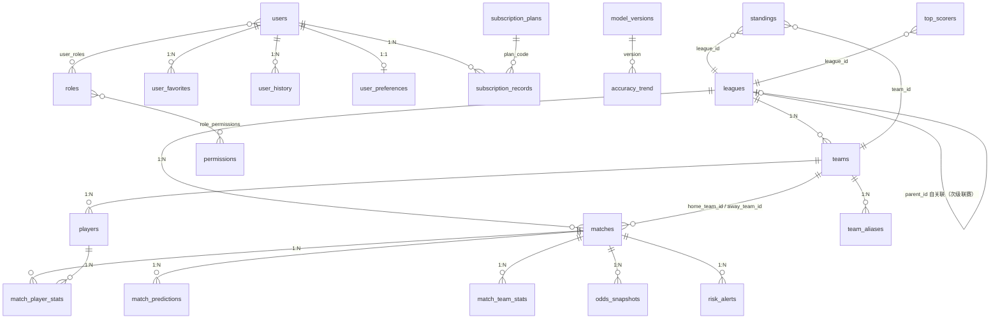

# 数据库表设计文档

> 项目：足球纯竞技量化分析工具 5.0 职业版（traesolo）
> 本文以 `backend/db/models.py`（ORM）+ `backend/db/database.py`（`ensure_schema`）+ `backend/alembic/` 为**唯一事实来源**整理。
> 旧文档 `DOC/database_schema.sql`（2026-07 版，仅 14 表）已滞后，**以本文为准**；差异见第 8 章。
> 字符集：MySQL `utf8mb4`；时间列均为 `TIMESTAMP` 服务器本地时间（无时区）；`created_at` 默认 `datetime.now`，`updated_at` 随更新刷新。

---

## 1. 总览

共 **28 张表**，按域分组：

| 域 | 表 |
|----|----|
| A. 赛事核心 | `leagues`、`teams`、`team_aliases`、`matches`、`odds_snapshots` |
| B. 球员与技术统计 | `players`、`match_player_stats`、`match_team_stats`、`standings`、`top_scorers` |
| C. 预测与模型 | `match_predictions`、`model_versions`、`training_records`、`accuracy_trend`、`risk_alerts` |
| D. 用户与订阅 | `users`、`user_favorites`、`user_followed_leagues`、`user_history`、`user_preferences`、`subscription_plans`、`subscription_records` |
| E. 权限（RBAC） | `roles`、`permissions`、`role_permissions`、`user_roles` |
| F. 系统与运维 | `operation_logs`、`crawl_logs`、`scheduled_task_status` |

### 1.1 核心关系图

### 1.2 命名与通用约定

- 表名：`snake_case` 复数（关联表 `a_b` 组合）；
- 主键：业务主键用 `String`（如 `leagues.id='EPL'`、`matches.id`），流水表用自增 `Integer`；
- 索引：`idx_<表>_<列>`；唯一约束：`uk_<表>_<列>` 为准（历史遗留 `uq_match_player`、`uq_match_team_stat` 不强制改名）；
- 外键均**未配 `ON DELETE CASCADE`**，删除由业务层控制（防误删连锁清数据）；
- 枚举值变更走 `ensure_schema` 差异比对后 ALTER，禁止无条件 MODIFY（元数据锁风险）。

---

## 2. A. 赛事核心域

### 2.1 `leagues` — 联赛表

| 字段 | 类型 | 约束/默认 | 说明 |
|------|------|-----------|------|
| id | String(20) | **PK** | 联赛编码，如 `EPL`、`LALIGA`、`UCL` |
| name | String(100) | NOT NULL | 中文名 |
| icon | String(50) | | 图标（emoji） |
| logo | String(255) | | logo URL |
| region | String(50) | | 地区，如 `欧洲` |
| category | String(20) | default `'international'` | 类别 |
| country | String(50) | | 国家 |
| flag | String(50) | | 旗帜 |
| level | Integer | default 1 | 级别（1=顶级，2=次级如英冠） |
| parent_id | String(20) | FK → `leagues.id`，NULL | 自关联：次级联赛指向母联赛 |
| avg_goals | DECIMAL(4,2) | default 2.70 | 联赛场均进球（泊松先验） |
| is_active | Boolean | default True | 是否启用采集 |
| source_url | String(255) | | 500.com 数据源页面 |
| created_at / updated_at | TIMESTAMP | | |

索引：`idx_leagues_parent_id(parent_id)`（`ensure_schema` 补齐）。

### 2.2 `teams` — 球队表

| 字段 | 类型 | 约束/默认 | 说明 |
|------|------|-----------|------|
| id | String(20) | **PK** | 球队编码 |
| name | String(100) | NOT NULL | 全称 |
| short_name | String(20) | NOT NULL | 简称 |
| logo | String(255) | | |
| league_id | String(20) | FK → `leagues.id` | |
| country | String(50) | | |
| elo_rating | Integer | default 1500 | ELO 评分（训练时序更新） |
| attack_strength | DECIMAL(4,3) | default 1.000 | 泊松进攻强度 |
| defense_strength | DECIMAL(4,3) | default 1.000 | 泊松防守强度 |
| xg_for | DECIMAL(5,3) | default 1.350 | 场均期望进球 |
| xg_against | DECIMAL(5,3) | default 1.350 | 场均期望失球 |
| home_ground | String(100) | | 主场 |
| founded_year | Integer | | |
| created_at / updated_at | TIMESTAMP | | |

### 2.3 `team_aliases` — 队名别名表

> 用途：多数据源队名映射（500.com / ESPN 等），DB 可维护，优先于硬编码 `TEAM_ALIASES` 补丁。

| 字段 | 类型 | 约束/默认 | 说明 |
|------|------|-----------|------|
| id | Integer | **PK**，自增 | |
| alias | String(120) | NOT NULL | 别名（源站队名） |
| team_id | String(20) | FK → `teams.id`，NOT NULL | 映射到的标准球队 |
| league_id | String(20) | FK → `leagues.id`，NULL | 限定联赛上下文 |
| espn_abbr | String(20) | | ESPN 缩写 |
| status | Enum | `pending`/`confirmed`/`rejected`，default `pending` | 审核状态 |
| source | String(20) | default `'manual'` | 来源 |
| note | String(255) | | |
| created_at / updated_at | TIMESTAMP | | |

约束：`uk_team_alias(alias)` 唯一；索引 `idx_team_alias_team(team_id)`、`idx_team_alias_status(status)`。

### 2.4 `matches` — 赛事表（核心大表）

| 字段 | 类型 | 约束/默认 | 说明 |
|------|------|-----------|------|
| id | String(50) | **PK** | 赛事编码（含源站标识） |
| league_id | String(20) | FK → `leagues.id` | |
| home_team_id | String(20) | FK → `teams.id`，NOT NULL | |
| away_team_id | String(20) | FK → `teams.id`，NOT NULL | |
| match_date | DATE | NOT NULL | |
| match_time | TIME | | |
| venue | String(100) | | 球场 |
| weather | String(50) | | 天气（环境修正输入） |
| temperature | String(20) | | 气温 |
| pitch_condition | String(20) | | 草坪状况 |
| status | Enum | `upcoming`/`live`/`finished`，default `upcoming` | |
| home_goals / away_goals | Integer | default 0 | |
| result | Enum | `H`/`A`/`D`，NULL | 主胜/客胜/平 |
| fixture_id | String(30) | | 竞彩期号（500.com） |
| process_id | String(30) | | 竞彩场次号 |
| handicap | Integer | | 让球数 |
| odds_nspf_win / draw / lose | DECIMAL(6,2) | | 竞彩不让球胜平负赔率 |
| odds_spf_win / draw / lose | DECIMAL(6,2) | | 竞彩让球胜平负赔率 |
| odds_bf_json | TEXT | | 比分玩法 SP：JSON 映射 `比分→赔率`（含胜/平/负其它） |
| is_single | Boolean | default False | 单关标识 |
| buy_end_time | String(30) | | 截止销售时间 |
| stage | Enum | 见下，default `'league'` | 赛段 |
| group_name | String(10) | | 小组名 |
| round_name | String(20) | | 轮次名 |
| created_at / updated_at | TIMESTAMP | | |

`stage` 枚举（11 值）：`group`、`round_of_16`、`quarter_final`、`semi_final`、`third_place`、`final`、`league`、`qualifying`、`knockout`、`playoff`、`play_in`。

索引：`idx_matches_status_date_league(status, match_date, league_id)`（高频列表查询，`ensure_schema`/Alembic `001_perf_indexes` 双路幂等补齐）。

### 2.5 `odds_snapshots` — 赔率时序快照表

> 用途：赔率变化时序分析（**仅供研究，非投注建议**）。

| 字段 | 类型 | 约束/默认 | 说明 |
|------|------|-----------|------|
| id | Integer | **PK**，自增 | |
| match_id | String(50) | FK → `matches.id`，NOT NULL | |
| fixture_id | String(30) | | 竞彩期号冗余 |
| source | String(20) | default `'500_trade'` | 来源 |
| captured_at | TIMESTAMP | NOT NULL，default now | 抓取时刻 |
| handicap | Integer | | 让球数 |
| odds_nspf_win / draw / lose | DECIMAL(6,2) | | 不让球赔率快照 |
| odds_spf_win / draw / lose | DECIMAL(6,2) | | 让球赔率快照 |
| odds_bf_json | TEXT | | 抓取当时的竞彩比分 SP。赛果回写只改 `matches.odds_bf_json`，赛前价以本列、且 `captured_at` 不晚于开赛的最后一帧为准 |
| created_at | TIMESTAMP | | |

索引：`idx_odds_snap_match_time(match_id, captured_at)`、`idx_odds_snap_fixture(fixture_id)`。

---

## 3. B. 球员与技术统计域

### 3.1 `players` — 球员表

| 字段 | 类型 | 约束/默认 | 说明 |
|------|------|-----------|------|
| id | String(30) | **PK** | |
| name | String(100) | NOT NULL | |
| short_name | String(20) | | |
| jersey_number | Integer | | 球衣号 |
| position | Enum | `GK/CB/RB/LB/DM/CM/AM/RM/LM/RW/LW/ST` | |
| team_id | String(20) | FK → `teams.id` | |
| nationality | String(50) | | |
| birth_date | DATE | | |
| height / weight | Integer | | cm / kg |
| foot | Enum | `left`/`right`/`both` | 惯用脚 |
| market_value | DECIMAL(15,2) | | 身价 |
| goals / assists / appearances | Integer | default 0 | 赛季累计（软先验输入） |
| yellow_cards / red_cards | Integer | default 0 | |
| photo | String(255) | | |
| created_at / updated_at | TIMESTAMP | | |

索引：`idx_players_team(team_id)`、`idx_players_position(position)`。

### 3.2 `match_player_stats` — 赛事球员统计表

| 字段 | 类型 | 约束/默认 | 说明 |
|------|------|-----------|------|
| id | Integer | **PK**，自增 | |
| match_id | String(50) | FK → `matches.id`，NOT NULL | |
| player_id | String(30) | FK → `players.id`，NOT NULL | |
| team_id | String(20) | FK → `teams.id` | |
| is_home | Boolean | NOT NULL | |
| position | Enum | 同 `players.position` | 本场位置 |
| goals / assists | Integer | default 0 | |
| shots / shots_on_target | Integer | default 0 | 射门/射正（xG 输入） |
| passes | Integer | default 0 | |
| pass_accuracy | DECIMAL(5,2) | | 传球成功率 % |
| tackles / interceptions / clearances | Integer | default 0 | 抢断/拦截/解围 |
| dribbles / dribble_success | Integer | default 0 | 过人/成功 |
| fouls_committed / fouls_suffered | Integer | default 0 | 犯规/被犯 |
| yellow_cards / red_cards | Integer | default 0 | |
| minutes_played | Integer | default 0 | |
| rating | DECIMAL(3,1) | | 赛后评分 |
| created_at / updated_at | TIMESTAMP | | |

约束：`uq_match_player(match_id, player_id)` 唯一；索引 `idx_match_player_match`、`idx_match_player_player`、`idx_match_player_team`。

### 3.3 `match_team_stats` — 赛事球队技术统计表

> 用途：射门/射正/控球等队级数据，供 xG 模型及 ESPN 缺球员行时兜底。

| 字段 | 类型 | 约束/默认 | 说明 |
|------|------|-----------|------|
| id | Integer | **PK**，自增 | |
| match_id | String(50) | FK → `matches.id`，NOT NULL | |
| team_id | String(20) | FK → `teams.id`，NOT NULL | |
| is_home | Boolean | NOT NULL | |
| shots / shots_on_target | Integer | default 0 | |
| possession | DECIMAL(5,2) | | 控球率 % |
| corners | Integer | | 角球 |
| source | String(20) | default `'unknown'` | 数据来源 |
| created_at / updated_at | TIMESTAMP | | |

约束：`uq_match_team_stat(match_id, team_id)` 唯一；索引 `idx_match_team_match`、`idx_match_team_team`。

### 3.4 `standings` — 积分榜

| 字段 | 类型 | 约束/默认 | 说明 |
|------|------|-----------|------|
| id | Integer | **PK**，自增 | |
| league_id | String(20) | FK → `leagues.id`，NOT NULL | |
| team_id | String(20) | FK → `teams.id`，NOT NULL | |
| season | String(20) | NOT NULL | 如 `2025-2026` |
| rank | Integer | default 0 | |
| played / won / drawn / lost | Integer | default 0 | |
| goals_for / goals_against / goal_diff | Integer | default 0 | |
| points | Integer | default 0 | |
| update_date | DATE | | 数据日期 |
| created_at / updated_at | TIMESTAMP | | |

约束：`uk_standings_league_team_season(league_id, team_id, season)` 唯一。

### 3.5 `top_scorers` — 射手榜

| 字段 | 类型 | 约束/默认 | 说明 |
|------|------|-----------|------|
| id | Integer | **PK**，自增 | |
| player_name | String(100) | NOT NULL | 未关联 `players`（源站直采，名字为准） |
| team_id | String(20) | FK → `teams.id` | |
| league_id | String(20) | FK → `leagues.id`，NOT NULL | |
| season | String(20) | NOT NULL | |
| goals / assists / games_played | Integer | default 0 | |
| rank | Integer | default 0 | |
| update_date | DATE | | |
| created_at / updated_at | TIMESTAMP | | |

---

## 4. C. 预测与模型域

### 4.1 `match_predictions` — 赛事预测表

| 字段 | 类型 | 约束/默认 | 说明 |
|------|------|-----------|------|
| id | Integer | **PK**，自增 | 一场可多版本预测（重算追加） |
| match_id | String(50) | FK → `matches.id`，NOT NULL | |
| model_version | String(20) | default `'v5.0.0'` | |
| lambda_home / lambda_away | DECIMAL(4,2) | | 泊松期望进球 |
| home_win_prob / draw_prob / away_win_prob | DECIMAL(6,4) | | 胜/平/负概率 |
| main_score | String(10) | | 主线比分 |
| alt_scores | TEXT | | 备选比分（JSON） |
| total_goals | String(20) | | 总进球区间 |
| tendency | String(200) | | 倾向描述 |
| confidence | Enum | `high`/`mid`/`low` | 信心 |
| risk_level | Enum | `high`/`mid`/`low` | 风险 |
| key_variables | TEXT | | 关键变量（JSON） |
| analysis | TEXT | | 分析文案 |
| score_matrix | TEXT | | 比分概率矩阵（JSON） |
| meta_json | TEXT | | 扩展：xG、权重来源、场景等 |
| created_at / updated_at | TIMESTAMP | | |

索引：`idx_predictions_match_created(match_id, created_at)`（取最新预测）。

### 4.2 `model_versions` — 模型版本表

| 字段 | 类型 | 约束/默认 | 说明 |
|------|------|-----------|------|
| id | Integer | **PK**，自增 | |
| version | String(20) | **唯一**，NOT NULL | 如 `v5.0.0` |
| description | TEXT | | |
| accuracy | DECIMAL(5,2) | | 命中率 % |
| status | Enum | `current`/`archived`，default `current` | |
| training_data_start / end | DATE | | 训练样本区间 |
| weights_json | TEXT | | 融合权重（全局+分联赛），启动时加载 |
| created_at | TIMESTAMP | | |

### 4.3 `training_records` — 模型训练记录

| 字段 | 类型 | 约束/默认 | 说明 |
|------|------|-----------|------|
| id | Integer | **PK**，自增 | |
| status | Enum | `running`/`success`/`failed`，default `running` | |
| message | String(255) | | |
| model_version | String(20) | | 产出版本 |
| total_matches | Integer | default 0 | 样本量 |
| data_start / data_end | DATE | | 样本区间 |
| accuracy | DECIMAL(6,4) | | 主指标 |
| duration_ms | Integer | default 0 | |
| results_json | TEXT | | 分联赛指标明细 |
| suggestions_json | TEXT | | 训练建议 |
| snapshot_json | TEXT | | 权重快照 |
| started_at | TIMESTAMP | default now | |
| finished_at | TIMESTAMP | NULL | |

索引：`idx_training_records_started(started_at)`。

### 4.4 `accuracy_trend` — 模型准确率趋势

| 字段 | 类型 | 约束/默认 | 说明 |
|------|------|-----------|------|
| id | Integer | **PK**，自增 | |
| model_version | String(20) | FK → `model_versions.version`，NOT NULL | |
| date | DATE | NOT NULL | |
| accuracy | DECIMAL(5,2) | | |
| total_matches / correct_matches | Integer | default 0 | |
| created_at | TIMESTAMP | | |

约束：`uk_trend_date_version(date, model_version)` 唯一。

### 4.5 `risk_alerts` — 风险预警表

| 字段 | 类型 | 约束/默认 | 说明 |
|------|------|-----------|------|
| id | Integer | **PK**，自增 | |
| match_id | String(50) | FK → `matches.id`，NULL | |
| match_name | String(200) | | 冗余赛事名 |
| type | Enum | `data_abnormal`/`high_risk`/`weather`/`pitch`/`injury`，NOT NULL | |
| level | Enum | `high`/`mid`/`low`，NOT NULL | |
| description | TEXT | | |
| recommended_action | TEXT | | |
| is_processed | Boolean | default False | |
| created_at | TIMESTAMP | | |

---

## 5. D. 用户与订阅域

### 5.1 `users` — 用户表

| 字段 | 类型 | 约束/默认 | 说明 |
|------|------|-----------|------|
| id | Integer | **PK**，自增 | |
| username | String(50) | **唯一**，NOT NULL | |
| email | String(100) | **唯一**，NOT NULL | |
| password_hash | String(255) | NOT NULL | |
| avatar | String(255) | | |
| level | String(20) | default `'free'` | 等级展示 |
| favorite_team_id | String(20) | FK → `teams.id` | |
| join_date | DATE | | |
| total_analysis | Integer | default 0 | 累计分析次数 |
| subscription_plan | String(30) | default `'free'` | 当前套餐码（冗余快照） |
| subscription_expire | DATE | | 到期日 |
| subscription_status | Enum | `active`/`expired`/`cancelled`，default `expired` | |
| is_active | Boolean | default True | 禁用标记 |
| last_login_at | TIMESTAMP | | |
| created_at / updated_at | TIMESTAMP | | |

### 5.2 `subscription_plans` — 订阅套餐定义

| 字段 | 类型 | 约束/默认 | 说明 |
|------|------|-----------|------|
| code | String(30) | **PK** | 套餐码，如 `free`/`pro`/`flagship` |
| name | String(50) | NOT NULL | |
| tier | String(20) | NOT NULL，default `'free'` | 层级 |
| duration_days | Integer | default 0 | 0 = 不限时长（免费版） |
| price | DECIMAL(10,2) | default 0 | |
| features_json | TEXT | | 权益码列表（JSON） |
| description | String(255) | | |
| is_active | Boolean | default True | |
| sort_order | Integer | default 0 | |
| created_at / updated_at | TIMESTAMP | | |

### 5.3 `subscription_records` — 订阅流水

> 开通/续费/取消流水；任一时刻每用户至多一条 `active`。

| 字段 | 类型 | 约束/默认 | 说明 |
|------|------|-----------|------|
| id | Integer | **PK**，自增 | |
| user_id | Integer | FK → `users.id`，NOT NULL | |
| plan_code | String(30) | FK → `subscription_plans.code`，NOT NULL | |
| start_date | DATE | NOT NULL | |
| end_date | DATE | NULL | free 套餐为 NULL |
| status | Enum | `active`/`expired`/`cancelled`，default `active` | |
| source | String(20) | default `'admin_grant'` | 来源（后台发放等） |
| operator_id | Integer | FK → `users.id`，NULL | 操作人 |
| note | String(255) | | |
| created_at | TIMESTAMP | | |

索引：`idx_sub_records_user(user_id)`、`idx_sub_records_status(status)`。

### 5.4 `user_favorites` — 用户收藏表

| 字段 | 类型 | 约束/默认 | 说明 |
|------|------|-----------|------|
| id | Integer | **PK**，自增 | |
| user_id | Integer | FK → `users.id`，NOT NULL | |
| match_id | String(50) | FK → `matches.id`，NULL | |
| team_id | String(20) | FK → `teams.id`，NULL | |
| type | Enum | `match`/`team`，NOT NULL | |
| created_at | TIMESTAMP | | |

约束：`uk_fav_user_match(user_id, match_id)`、`uk_fav_user_team(user_id, team_id)` 双唯一。

### 5.4b `user_followed_leagues` — 用户关注联赛

与收藏赛事/球队分开。关注对象是 `leagues.id`，默认不展开 `parent_id` 子项。

| 字段 | 类型 | 约束/默认 | 说明 |
|------|------|-----------|------|
| id | Integer | **PK**，自增 | |
| user_id | Integer | FK → `users.id`，NOT NULL | ON DELETE CASCADE |
| league_id | String(20) | FK → `leagues.id`，NOT NULL | ON UPDATE CASCADE，删联赛时服务层清关注 |
| sort_order | Integer | default 0 | |
| created_at | TIMESTAMP | | |

约束：`uk_user_followed_league(user_id, league_id)`。上限 20；下级展开不占名额。

### 5.5 `user_history` — 用户历史分析记录

| 字段 | 类型 | 约束/默认 | 说明 |
|------|------|-----------|------|
| id | Integer | **PK**，自增 | |
| user_id | Integer | FK → `users.id`，NOT NULL | |
| match_id | String(50) | FK → `matches.id`，NOT NULL | |
| match_name | String(200) | | |
| prediction | String(20) | | 预测结果 |
| actual | String(20) | | 实际结果 |
| result | Enum | `correct`/`partial`/`wrong` | 命中评定 |
| created_at | TIMESTAMP | | |

### 5.6 `user_preferences` — 用户偏好设置（1:1）

| 字段 | 类型 | 约束/默认 | 说明 |
|------|------|-----------|------|
| user_id | Integer | **PK**，FK → `users.id` | |
| push_notification | Boolean | default True | |
| refresh_interval | Integer | default 5 | 分钟 |
| default_league_id | String(20) | FK → `leagues.id` | |
| follow_include_children | Boolean | default False | 关注过滤是否展开下级联赛 |
| theme | String(20) | default `'dark'` | |
| language | String(20) | default `'zh-CN'` | |
| created_at / updated_at | TIMESTAMP | | |

---

## 6. E. 权限域（RBAC）

### 6.1 `roles` — 角色表

| 字段 | 类型 | 约束/默认 | 说明 |
|------|------|-----------|------|
| id | Integer | **PK**，自增 | |
| name | String(50) | **唯一**，NOT NULL | 显示名 |
| code | String(50) | **唯一**，NOT NULL | 如 `super_admin`/`admin`/`operator`/`analyst`/`user` |
| description | String(255) | | |
| is_system | Boolean | default False | 系统内置不可删 |
| created_at / updated_at | TIMESTAMP | | |

### 6.2 `permissions` — 权限表

| 字段 | 类型 | 约束/默认 | 说明 |
|------|------|-----------|------|
| id | Integer | **PK**，自增 | |
| name | String(100) | NOT NULL | |
| code | String(100) | **唯一**，NOT NULL | `资源:动作`，如 `match:manage` |
| type | String(20) | default `'menu'` | menu / action 等 |
| parent_id | Integer | default 0 | 树形（0=根） |
| path | String(255) | | 前端路由路径 |
| icon | String(50) | | |
| sort_order | Integer | default 0 | |
| description | String(255) | | |
| created_at / updated_at | TIMESTAMP | | |

### 6.3 `role_permissions` / 6.4 `user_roles` — 关联表

| 表 | 字段 | 说明 |
|----|------|------|
| `role_permissions` | `role_id`（PK，FK→roles）、`permission_id`（PK，FK→permissions）、`created_at` | 联合主键 |
| `user_roles` | `user_id`（PK，FK→users）、`role_id`（PK，FK→roles）、`created_at` | 联合主键 |

> 鉴权链路：登录时 `load_user_auth_payload` 汇总 roles + permissions 写入 token 会话；`super_admin`/`admin` 角色在 `user_has_any_permission` 直接放行。

---

## 7. F. 系统与运维域

### 7.1 `operation_logs` — 操作日志

| 字段 | 类型 | 约束/默认 | 说明 |
|------|------|-----------|------|
| id | Integer | **PK**，自增 | |
| user_id | Integer | FK → `users.id`，NULL | |
| action | String(100) | NOT NULL | 操作名 |
| resource_type | String(50) | | |
| resource_id | String(100) | | |
| detail | TEXT | | |
| ip_address | String(50) | | |
| created_at | TIMESTAMP | | |

### 7.2 `crawl_logs` — 采集日志

| 字段 | 类型 | 约束/默认 | 说明 |
|------|------|-----------|------|
| id | Integer | **PK**，自增 | |
| crawl_type | String(20) | NOT NULL，default `'manual'` | manual / scheduled 等 |
| crawl_category | String(20) | NOT NULL，default `'match'` | match / stats / player 等 |
| league_id | String(20) | | 未设 FK（允许采集未入库联赛） |
| league_name | String(100) | | |
| found_count / saved_count / updated_count | Integer | default 0 | 发现/新增/更新数 |
| status | Enum | `success`/`failed`，NOT NULL | |
| error_message | TEXT | | |
| crawled_data | TEXT | | 原始数据快照 |
| log_file | String(500) | | 关联运行日志文件 |
| started_at | TIMESTAMP | NOT NULL | |
| finished_at | TIMESTAMP | NULL | |
| duration_ms | Integer | | |

索引：`idx_crawl_logs_type`、`idx_crawl_logs_category`、`idx_crawl_logs_league`、`idx_crawl_logs_status`、`idx_crawl_logs_started_at`。

### 7.3 `scheduled_task_status` — 定时任务状态表

> 持久化任务启用/停止状态，重启后据此恢复（任务注册唯一数据源：`services/scheduled_tasks.py`）。

| 字段 | 类型 | 约束/默认 | 说明 |
|------|------|-----------|------|
| task_id | String(50) | **PK** | 任务标识 |
| is_enabled | Boolean | NOT NULL，default False | |
| interval_minutes | Integer | default 60 | |
| last_run_at | TIMESTAMP | NULL | |
| created_at / updated_at | TIMESTAMP | | |

---

## 8. Schema 演进机制与旧版差异

### 8.1 演进机制（三条路径）

1. **`create_all`**（`main.py` 启动时）：只建缺失表，不 ALTER；
2. **`ensure_schema()`**（`db/database.py`）：幂等补列 / ENUM 差异比对后 ALTER / 补索引 / 激活扩围联赛并回填 `parent_id`；MySQL 下统一 `SET SESSION lock_wait_timeout = 5`，拿不到锁则跳过、下次启动重试；
3. **Alembic**：当前仅 `001_perf_indexes`（matches / match_predictions 两索引，幂等）；后续索引类或大变更建议 `alembic revision --autogenerate`。

启动时序：`create_all` → `ensure_schema()` → `init_database()`（种子：联赛/球队/管理员/角色权限/订阅套餐）。

### 8.2 与 `DOC/database_schema.sql`（2026-07 版）差异

**旧版缺失的 14 张表**（现已上线）：

`team_aliases`、`players`、`match_player_stats`、`match_team_stats`、`odds_snapshots`、`training_records`、`scheduled_task_status`、`crawl_logs`、`subscription_plans`、`subscription_records`、`roles`、`permissions`、`role_permissions`、`user_roles`

**旧表新增的关键列**：

- `matches`：`fixture_id`、`process_id`、`handicap`、`odds_nspf_*`、`odds_spf_*`、`odds_bf_json`、`is_single`、`buy_end_time`、`stage`（扩至 11 枚举值）、`group_name`、`round_name`、环境字段（`weather`/`temperature`/`pitch_condition`）
- `teams`：`xg_for`、`xg_against`
- `leagues`：`parent_id`、`source_url`、`is_active`
- `match_predictions`：`meta_json`
- `users`：订阅三列（`subscription_plan`/`subscription_expire`/`subscription_status`）、`is_active`、`last_login_at`

**新增索引**：`idx_matches_status_date_league`、`idx_predictions_match_created`、`idx_leagues_parent_id`。

### 8.3 已知设计注意点

| 项 | 说明 |
|----|------|
| 外键无级联删除 | 删除走业务层，防连锁误删 |
| `top_scorers.player_name` 未关联 `players` | 源站直采以名字为准，后续可经 `team_aliases` 类似机制做球员映射 |
| `crawl_logs.league_id` 未设 FK | 允许记录未入库联赛的采集 |
| 唯一约束 `uk_`/`uq_` 双前缀 | 历史遗留，新表统一 `uk_` |
| `users.subscription_*` 为冗余快照 | 权威数据在 `subscription_records`（至多一条 active），快照由订阅服务维护 |
| 时间列无时区 | 全部服务器本地时间，跨时区部署需注意 |
